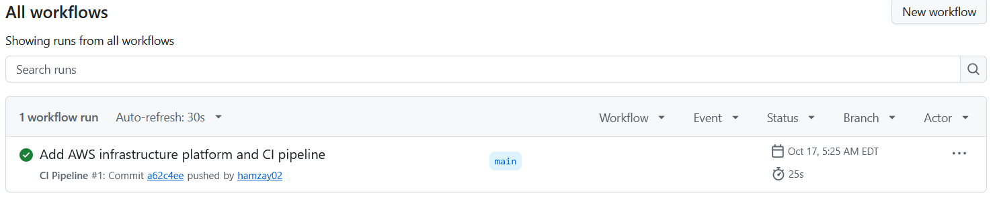

# Production-Style AWS Infrastructure & DevSecOps Platform

## Overview

This project demonstrates a cloud infrastructure workflow using Python, Flask, Docker, Pulumi, AWS, and GitHub Actions.

The goal is to build a repeatable, security-conscious, and cost-aware application infrastructure workflow while developing practical cloud engineering and DevSecOps skills.

## Technologies

- **Python** — application development and automation
- **Flask** — lightweight web application
- **Docker** — application containerization
- **Pulumi** — infrastructure as code using Python
- **AWS** — cloud infrastructure services
- **Amazon ECR** — container image registry
- **Amazon ECS / AWS Fargate** — container deployment architecture
- **Amazon CloudWatch** — logging and monitoring
- **GitHub Actions** — automated testing and Docker image builds
- **Python unittest** — application testing
- **Docker Scout** — container image vulnerability assessment

## Project Features

- Flask application with home, health, and version endpoints
- Unit tests for application endpoints
- Docker image build using a slim Python base image
- Non-root container execution
- AWS infrastructure defined using Pulumi and Python
- IAM and network security configurations
- GitHub Actions workflow for automated tests and Docker builds
- Documentation covering architecture, security, deployment, and cost management

## Architecture

The intended architecture uses Pulumi to define AWS networking and supporting infrastructure, with a containerized Flask application and an Amazon ECR image repository.

The planned application deployment uses Amazon ECS with AWS Fargate. CloudWatch is intended for application logging.

See [Architecture Documentation](docs/evidence/architecture.md) for additional details.

## Testing and CI

The application includes unit tests for its main endpoints.

Run the tests locally:

```bash
python -m unittest discover -s tests -v
```

The three application unit tests passed locally. The GitHub Actions workflow also completed successfully, including the unit tests and Docker image build.

The workflow is defined in `.github/workflows/ci.yml`.

## Security

Security considerations incorporated into the project include:

- IAM permissions and access control
- Network security group rules
- Avoiding hardcoded AWS credentials
- Running the application container as a non-root user
- Container image vulnerability assessment using Docker Scout
- Reviewing infrastructure and configuration before deployment

The Docker Scout report recorded zero critical, one high, six medium, and 27 low vulnerabilities at the time of scanning. These results represent that scan, not a guarantee that the image is vulnerability-free.

See [Security Documentation](docs/evidence/security.md) and [Docker Security Notes](docs/evidence/docker-security-notes.md).

## Cost Management

The project prioritizes minimizing cloud costs during development.

- Review AWS resources before and after experiments.
- Avoid leaving temporary resources running.
- Use Pulumi to manage infrastructure lifecycle.
- Verify resource cleanup and billing rather than assuming all resources have been removed.

The Pulumi stack was destroyed, and checks confirmed no ECS clusters, ECR repositories, or CloudWatch log groups remained in the checked AWS region. These checks do not establish that every possible AWS resource has been removed.

See [Cost Management Documentation](docs/evidence/cost-management.md).


## GitHub Actions CI Evidence

The GitHub Actions workflow automates application testing and Docker image building.



## Project Documentation

- [Architecture](docs/evidence/architecture.md)
- [Deployment](docs/evidence/deployment.md)
- [Security](docs/evidence/security.md)
- [Cost Management](docs/evidence/cost-management.md)
- [Docker Security Notes](docs/evidence/docker-security-notes.md)
- [Infrastructure README](infrastructure/README.md)

## Project Status

| Component | Status |
|---|---|
| Flask application | Implemented |
| Application unit tests | Three tests passed |
| Docker image build | Successful |
| Pulumi infrastructure code | Implemented |
| GitHub Actions CI workflow | Successful |
| Docker Scout assessment | Report available |
| ECS/Fargate infrastructure configuration | Defined in Pulumi |
| Documentation | Complete |

## Learning Objectives

This project develops practical skills in cloud infrastructure, Python application development, containerization, infrastructure as code, CI automation, network security, IAM, monitoring, and cost management.

## Disclaimer

This is a personal learning and portfolio project, not a production service. Deployment status and security findings are documented according to the work completed and evidence available.